<div align="center">

<!-- Animated Header -->


<!-- Profile Views + Followers -->
<p>
  
  
</p>

<!-- Typing SVG -->


</div>

---

## 🧑‍💻 About Me

```dart
class Amr extends CppFoundation implements FlutterDeveloper, AIExplorer {
  @override
  final String name = 'Amr Sa3dwy';

  final String university = 'South Valley National University';
  final String track = 'Computer Science & Artificial Intelligence';
  final String graduating = 'Expected June 2028';

  @override
  final String mainFocus = 'Flutter & Dart 📱';

  final List<String> levelingUp = [
    'State management: Provider & BLoC/Cubit 🧩',
    'Wiring AI into mobile apps 🧠',
  ];

  @override
  String get philosophy =>
      'Learning in public — sharing the process, not just the polished result.';
}
```

- 🎓 **CS & AI Student** at South Valley National University — graduating June 2028
- 📱 **Main Focus:** Flutter & Dart — shipping real, navigable mobile UIs one project at a time
- 🧩 **Leveling Up:** growing from `setState` into `Provider` and `BLoC/Cubit` for state management on newer builds
- 🧠 **Exploring:** how AI fits into mobile apps — the long-game of my CS & AI track
- 💻 **Foundation:** C++, OOP & Data Structures from my coursework
- 🌐 **Also Comfortable With:** HTML, CSS, JavaScript & Bootstrap
- 🤝 **Open to:** mobile dev opportunities, internships & open-source collaborations

---

## 🎓 Certifications & Training

- 🏅 **Python Basics** — ITI via Mahara-Tech → [View Certificate](https://github.com/Amr4924/My-Certifications/blob/main/Course_Certificate_En.pdf)
- 🏅 **AI For Everyone** — ITI *(completed)*
- ☁️ **NTI Cloud Essentials** — enrolled in the 120-hour program (networking, Red Hat administration, cloud fundamentals on AWS/Huawei)

---

## 🛠️ Languages & Tools

<div align="center">

### 📱 Mobile Development


### Core Languages


### Web Fundamentals


### Database & SQL


### Core Concepts


### Tools & Platforms


</div>

---

## 🚀 Featured Projects

### Flagship Builds

| Project | Description | Status |
|---|---|---|
| 💎 [M Jewellery](https://github.com/Amr4924/M-Jewellery) | Luxury jewellery shopping concept — bilingual EN/AR catalog, cinematic onboarding, `Provider`-powered cart & notifications |  |
| ✅ [HabitsAndTasks](https://github.com/Amr4924/HabitsAndTasks) | Bilingual to-do app with a full task lifecycle plus a Trash & recovery system, complete EN/AR localization with RTL |  |
| 📚 [Tech School](https://github.com/Amr4924/Tech-School) | Largest UI build to date — a fully navigable e-learning app: onboarding, login, dashboard, course catalog & profile |  |
| 🛒 [Sprint Store](https://github.com/Amr4924/Sprint-Store-) | E-commerce UI inspired by Vodafone Cash — grid layouts, custom widgets & layout composition practice |  |

<div align="center">
<sub>Live activity 👇 (updates on its own — no manual editing needed)</sub><br/><br/>


</div>

### 🎨 Earlier Practice Builds

| Project | Description |
|---|---|
| 💬 [Clone-WhatsApp-UI](https://github.com/Amr4924/Clone-WhatsApp-UI) | WhatsApp-inspired chat UI — dark theme, chat list, drawer, filter chips & bottom nav (UI only) |
| 🔐 [Flutter-Authentication-Demo](https://github.com/Amr4924/Flutter-Authentication-Demo) | My first steps in Flutter — login validation, bottom nav, drawer menu & logout flow |

### 🌱 Where It Started — C++ Foundations

| Project | Description |
|---|---|
| 🎓 [TermTracker](https://github.com/Amr4924/TermTracker) | GPA calculator & academic tracker |
| 🏧 [SmartATM](https://github.com/Amr4924/SmartATM) | Simulated ATM with core banking operations |
| 📝 [WordWizard](https://github.com/Amr4924/WordWizard) | Word manipulation & text-processing tool |
| 💰 [Expense-Tracker](https://github.com/Amr4924/Expense-Tracker) | Personal finance tracker with budget monitoring & category reports |

<div align="center"><sub><a href="https://github.com/Amr4924?tab=repositories">See all repositories →</a></sub></div>

---

## 📊 GitHub Statistics

<div align="center">
<div align="center">

<p align="center">
  
  
</p>

<p align="center" style="margin-top:25px;">
  
</p>
</div>



</div>

---

## 🏆 GitHub Trophies

<div align="center">


</div>

---

## 🧩 Problem Solving

<div align="center">

<a href="https://www.codewars.com/users/Sa3dwy" target="_blank">
  
</a>

<br/><br/>

<a href="https://codeforces.com/profile/Sa3dwy" target="_blank">
  
</a>

</div>

---

## 🌐 Let's Connect

<div align="center">

<a href="https://www.linkedin.com/in/amr-sa3dwy-53a51a343" target="_blank">
  
</a>
&nbsp;
<a href="mailto:amrsaad0016a@gmail.com" target="_blank">
  
</a>
&nbsp;
<a href="https://github.com/Amr4924" target="_blank">
  
</a>
&nbsp;
<a href="https://linktr.ee/sa3dwy" target="_blank">
  
</a>
&nbsp;
<a href="https://amr4924-github-io.vercel.app/" target="_blank">
  
</a>

</div>

---

<div align="center">


</div>
