


  
  

<a href="#about">About</a> &nbsp;/&nbsp;
<a href="#stack">Stack</a> &nbsp;/&nbsp;
<a href="#projects">Projects</a> &nbsp;/&nbsp;
<a href="#certifications">Certifications</a> &nbsp;/&nbsp;
<a href="#activity">Activity</a> &nbsp;/&nbsp;
<a href="#contact">Contact</a>

 

I'm a Computer Science student at South Valley National University (class of 2028) who builds cross-platform mobile apps with Flutter and Dart. I like shipping real, navigable products one project at a time, and I learn in public: the process matters as much as the polished result.

**What I'm working on now**

- **REST APIs.** Calling APIs from Flutter with Dio, and exploring and testing endpoints in Postman.
- **State management.** Moving from `setState` to Provider and BLoC/Cubit on newer builds.
- **AI in mobile apps.** Exploring how AI fits into mobile apps, the long game of my CS and AI studies.

**Foundation:** C++, OOP and data structures. I'm also comfortable with HTML, CSS, JavaScript and Bootstrap.

**Open to** mobile development opportunities, internships and open-source collaborations.


Exploring an endpoint in Postman, then making the same call from Flutter with Dio.

 

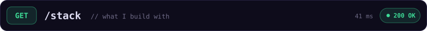


 

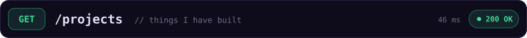

<a href="https://github.com/Amr4924/M-Jewellery">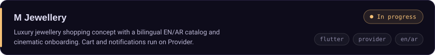</a>

<a href="https://github.com/Amr4924/HabitsAndTasks">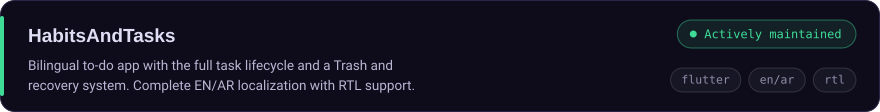</a>

<a href="https://github.com/Amr4924/Tech-School">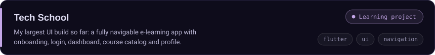</a>

<a href="https://github.com/Amr4924/Sprint-Store-">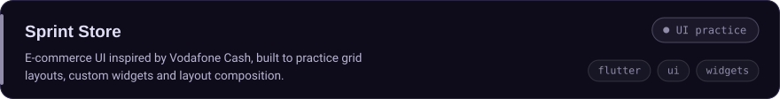</a>

  
  
  
  

Earlier practice builds and C++ foundations

 

| Project | What it is |
|---|---|
| [WhatsApp-inspired chat UI](https://github.com/Amr4924/Clone-WhatsApp-UI) | Dark theme, chat list, drawer, filter chips and bottom nav (UI only) |
| [Flutter authentication demo](https://github.com/Amr4924/Flutter-Authentication-Demo) | My first steps in Flutter: login validation, bottom nav, drawer menu and logout flow |
| [TermTracker](https://github.com/Amr4924/TermTracker) | C++ GPA calculator and academic tracker |
| [SmartATM](https://github.com/Amr4924/SmartATM) | C++ simulated ATM with core banking operations |
| [WordWizard](https://github.com/Amr4924/WordWizard) | C++ word manipulation and text-processing tool |
| [Expense-Tracker](https://github.com/Amr4924/Expense-Tracker) | C++ personal finance tracker with budget monitoring and category reports |

<a href="https://github.com/Amr4924?tab=repositories">See all repositories</a>

 

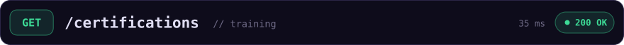

- **Python Basics**, ITI via Mahara-Tech. [View certificate](https://github.com/Amr4924/My-Certifications/blob/main/Course_Certificate_En.pdf)
- **AI For Everyone**, ITI. Completed.
- **NTI Cloud Essentials**, a 120-hour program covering networking, Red Hat administration and cloud fundamentals on AWS and Huawei. Enrolled.

 

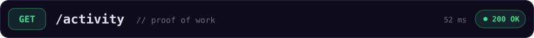

  <picture>
    <source media="(prefers-color-scheme: dark)" srcset="profile-3d-contrib/night.svg">
    <source media="(prefers-color-scheme: light)" srcset="profile-3d-contrib/day.svg">
    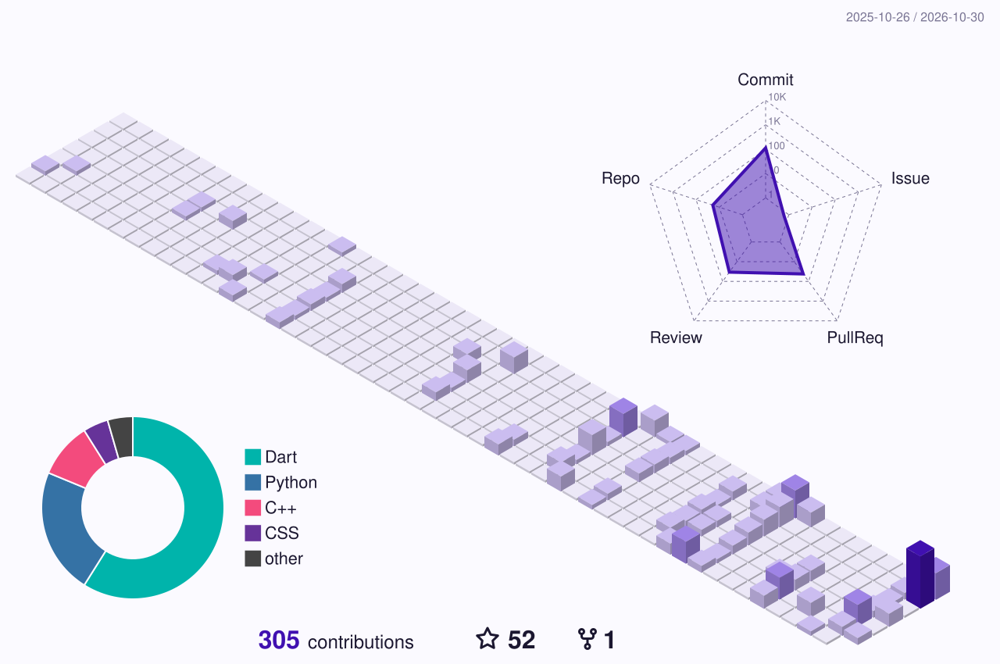
  </picture>


 

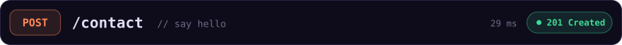

Open to mobile development roles, internships and open-source collaborations. LinkedIn or email is the fastest way to reach me.

  
  
  
  

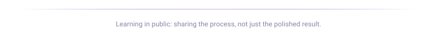

